# Best Mates — Project status

## Best Mates — v0.5.0 Final Development Milestone (2026-10-16)

- **Core development:** COMPLETE
- **UI/UX reconstruction:** COMPLETE
- **Visual design:** ACCEPTED
- **Physical-device acceptance:** ACCEPTED (human sign-off on Samsung One UI)
- **GitHub publication:** COMPLETE (v0.5.0 published on GitHub Releases)
- **Active feature development:** CLOSED
- **Future status:** COMMUNITY-DRIVEN MAINTENANCE ONLY

### Maintenance Policy from v0.5.0 Onward
1. **No additional features are planned.**
2. **No further visual redesign is planned.**
3. **No unnecessary architectural reconstruction.**
4. **Community feedback through GitHub Issues:** GitHub Issues remains open for reporting serious defects, security vulnerabilities, or necessary Android platform compatibility changes.
5. **Evaluation:** Community requests will be evaluated individually rather than automatically triggering another development cycle.
6. **Milestone preservation:** The current v0.5.0 release stands as a stable, verified historical milestone. Older planning documents, deferred tasks, and exploratory ideas (such as weather forecasts, analog hands, and cloud project sync) are historical non-goals, not unresolved bugs.

---

# 0.5.0 (versionCode 11) — Reconstruction & Review Baseline

Source of the work: `../REAL_DEVICE_FEEDBACK_2026-10-15.md` (BM-REAL-01…11). The Daybook
direction is kept. Everything was verified on both emulator and physical Samsung One UI device.
Aesthetic and functional approval confirmed by user.

APK: `app/build/outputs/apk/debug/app-debug.apk` (0.5.0, versionCode 11, ~33 MB, signed with
this PC's debug key `c7cef145…`). Evidence: `docs/review/2026-10-15/`.

## What changed, by feedback item

| Item | Root cause found | Change | Status |
|---|---|---|---|
| **01** Sun/Moon art | The picker offered all 28 older BM SVGs; several are malformed when rendered by AndroidSVG (stray arcs on the crescent ring, blobbed moon-and-cloud, a ghost stroke on the double moon), and the renderer crops each icon to its visible pixels, so sizes varied. | 29 original Daybook glyphs on one 48-unit grid (`tools/celestial/generate_celestial.py`), shown at their designed size. The picker offers only these, as a wrapping grid (nothing clipped). Older BM styles that have a redraw render through it; their saved IDs are unchanged. Other packs stay renderable for saved designs and show as a "classic" tile. | Verified (contact sheets) |
| **02** Black side bands | The launcher bitmap is the widget's full size, with the board fitted inside. When the cell's proportions differ from the board (Samsung 2×1 cells are wider than the default cell), two side margins stay empty, and the default dark drop shadow (14 dp) spilled into them. | The board adapts to the real cell (up to 35 % stretch). Shapes that span the board keep spanning it; everything else keeps its size and its place relative to the centre. Drawing is clipped to the board; shadows are cut out under translucent fills. Exact span sizes and each placed widget's size are recorded; the editor opens a placed design at those proportions. | Verified on Pixel launcher; **Samsung pending** |
| **03** Tap-switch | The hit test preferred the selected element whenever the finger was anywhere inside it, so a selected full-board shape won over the city above it. | Front-most element wins (`EditorHitTest`). A locked element in front lets the selection drag; tiny items get a 44 dp target; pinch on empty canvas acts on the selection. 12 regression tests. | Verified |
| **04** Snapping | Snap was already on, but a 7 dp threshold with no hysteresis felt weak; resizing had only edge snapping. | 9 dp catch, held until 1.6× away. Board edges, centre, thirds, quarters, and other elements' edges and centres; resize snaps to board fractions, other shapes' sizes and proportions (1:1, widget, natural, kept). Four edge handles, a haptic per magnet, the magnet toggle stays in the tools. | Verified on emulator |
| **05** Canvas size | The canvas took whatever the panel left, and the panel grew when selecting, so the board jumped and wide boards floated in empty space. | Canvas height follows the board's proportions at full width; a draggable split (double tap resets); tools moved into the panel header; the rotate knob adapts to the space. Wallpaper backdrop stays the default. | Verified |
| **06** Mist | New shapes used a 90 % dusk fill. | New shapes are Mist: a smoky veil with a top sheen and a light hairline edge, drawn by the shared renderer (editor = launcher). A Finish control switches Mist/Solid. | Verified |
| **07** Shapes | 12 shapes, some generic. | 13 new shapes (pebble, puff, soft heart, stamp, frame, note, bubble, ribbon, bloom, rosette, sparkle, crescent, sunburst) in four groups; the approved heart is unchanged. | Verified (contact sheet at 2:1, 1:1, 2:3) |
| **08** Empty stars | Random dots. | Mirror-symmetric four-point sparkles around the mark. | Verified |
| **09** Typography | — | Each style has its own display face; the empty-state headline is set in the display size. Time and date stay on live system faces (launcher limitation). | Partial |
| **10** Languages | de/fr/ru/tr/ar covered ~40 keys; the rest fell back to English; no RTL. | Complete tables for all seven languages, CLDR plurals (Russian one/few/many, Arabic six forms), localized dates, continents and country names, right-to-left layout for Arabic. `StringCoverageTest` fails the build on any missing key, plural form, placeholder mismatch or hard-coded UI text. | Verified (ar, ru on emulator) |
| **11** Themes | The four identities only changed an accent colour. | Four complete styles (Daybook, Rosewater, Nocturne, Studio): palette, surfaces, display typeface, corner geometry; live previews in Settings; same stored keys, so existing choices resolve; widgets are untouched. | Verified |

## Before and after (emulator, same data)

| | Before (0.4.0) | After (0.5.0) |
|---|---|---|
| Sky picker | 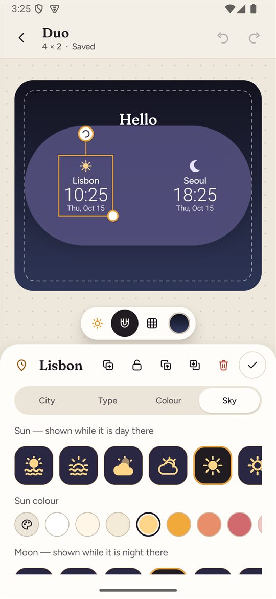 |  |
| Tap a city on a selected shape | 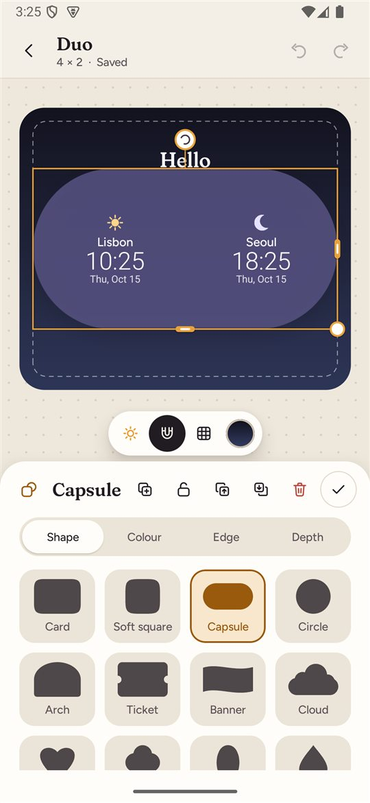 | 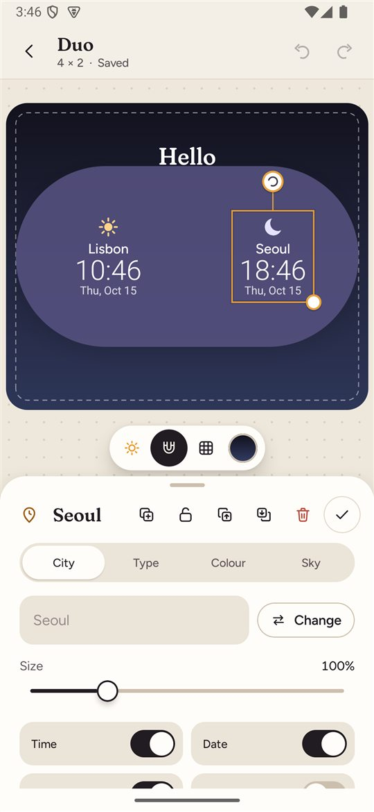 |
| 4×1 editor | 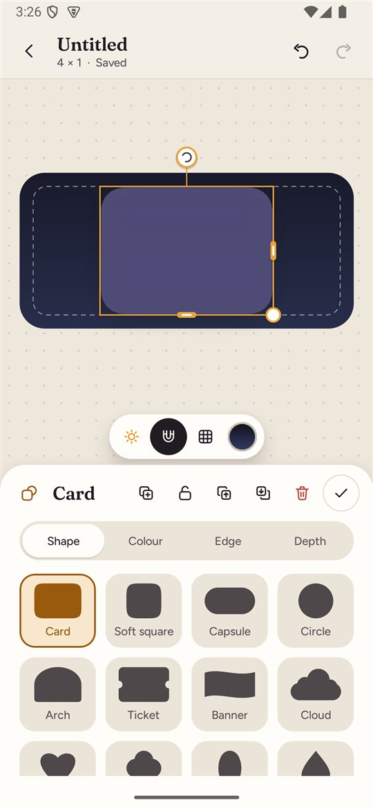 | 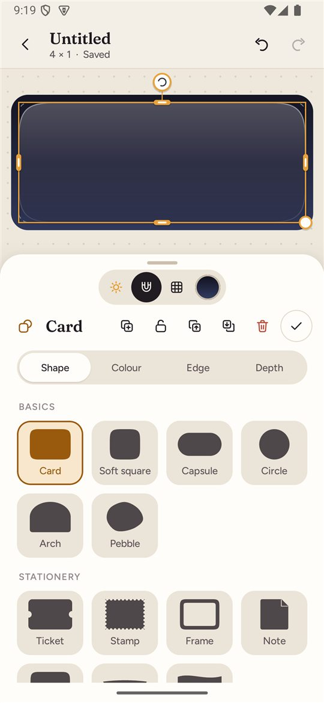 |
| Shape library | 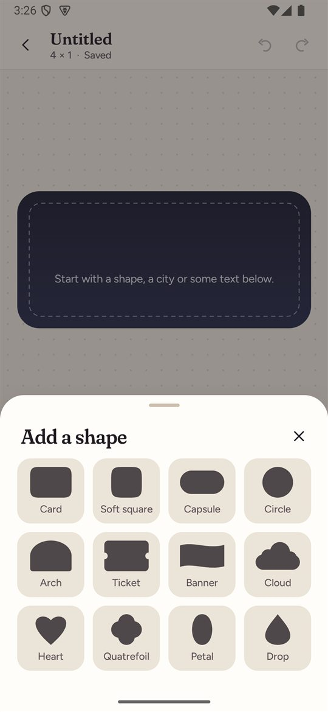 |  |

Also in `docs/review/2026-10-15/`: `celestial-daybook-contact-sheet.jpg` (new set at the
widget glyph, tile and large sizes, plus a bright-wallpaper swatch), `celestial-audit-1…4.jpg`
(all 121 styles with KEEP / REDRAW / REMOVED status, drawn by the production renderer),
`shapes-contact-sheet.jpg` (every shape at 2:1, 1:1, 2:3 in Mist and Solid on bright and
dark wallpaper), `styles-workspace.jpg`, `arabic-rtl.jpg`, `russian.jpg`,
`after-home-widgets.jpg`, `after-snap-guides.jpg`, `after-empty-workspace.jpg`,
`after-settings-styles.jpg`. Debug builds regenerate the sheets:
`adb shell am start -n com.bestmates.worldclock/.debug.CelestialContactSheetActivity`
(and `.debug.ShapeContactSheetActivity`); PNGs land in `Android/data/<package>/files/review/`.

## Data compatibility
- No schema migration was needed (layout version stays 9). New fields are optional:
  layers gain `material` (missing → `solid`, so saved shapes look the same), and new enum
  values are added, never renamed. A 0.4 build reading 0.5 data falls back to defaults
  for unknown shape or icon names.
- Saved sun/moon IDs are unchanged. Older BM styles with a Daybook redraw now draw with the
  redraw; reverting the build restores the old artwork.
- Placed widgets re-render with the adaptive board. Opening a project whose widget is on
  the home screen adopts the widget's proportions; that is saved on the next edit.
- The app theme preference keeps its stored values (`CLOUD`, `DREAM`, `MIDNIGHT`, `MONO`).
- Verified on the emulator: 0.4.0 → 0.5.0 in-place upgrade with six projects (three of them
  seeded v8 data) and a widget placed under 0.4.0; nothing lost; the widget re-rendered.

## Verification
- 99 JVM tests pass (54 before this iteration), including hit testing, resize magnets,
  hysteresis, widget reflow, the sun/moon catalogue and the translation gate.
- Emulator, verified: tap-switch from a selected shape to a city; magnet guides during a
  drag; new 4×1 Mist card pinned to the home screen fills its cell edge to edge; a legacy
  4×4 widget keeps its caption on its card; all four styles; Arabic RTL; Russian plurals;
  empty Workspace; Sky picker; shape library.

## Known limitations
- **Samsung One UI not tested.** The side-band fix follows the observed mechanism, but the
  user's phone must confirm it, at 2×1, 2×2 and 4×4.
- Mist darkens bright wallpapers slightly so white type stays legible; on very light
  wallpaper it reads as smoked glass. A lighter "Frost" palette remains available.
- Live time and date still use system typefaces (launcher restriction).
- Translations are careful but not reviewed by native speakers.
- Undo/redo glyphs are not mirrored in Arabic.

## Samsung check steps (needs your go-ahead to install)
1. Read-only signature check (changes nothing):
   ```powershell
   $apk = (C:\ADB\adb.exe shell pm path com.bestmates.worldclock).Replace("package:", "").Trim()
   C:\ADB\adb.exe pull $apk "$env:TEMP\bm-installed.apk"
   & "C:\Users\JCLXJ\AppData\Local\Android\Sdk\build-tools\35.0.0\apksigner.bat" verify --print-certs "$env:TEMP\bm-installed.apk"
   ```
   Only if it prints `c7cef145…`: `C:\ADB\adb.exe install -r app\build\outputs\apk\debug\app-debug.apk`.
   Never uninstall: that erases the projects.
2. Open an existing project with a placed widget; confirm it still looks right on the home screen.
3. 2×1: new widget → Card from the one-tap strip (full-bleed Mist) → Add to home screen.
   Check that the left and right edges show no black bands. Repeat at 2×2 and 4×4, with
   Solid and Mist, and resize a placed widget.
4. Select the card, then tap a city or text on it: the selection should switch in one tap.
5. Drag a shape near the centre or an edge, and resize from a corner towards a square:
   guides appear, a tick is felt, and it holds until you move clearly away.
6. Sky tab: every icon visible, none cut off; check day and night on the widget.
7. Settings → Style: switch styles; restart the app; the choice persists; widgets unchanged.
8. Settings → Language: Deutsch, Русский, Türkçe, العربية, Français — no English left.

## Next steps
1. Samsung confirmation of BM-REAL-02 (bands) and the snapping feel; tune thresholds if needed.
2. Mist on very light wallpapers: a lighter variant chosen from the wallpaper's tone.
3. Native-speaker review of de/fr/ru/tr/ar; mirrored undo/redo in Arabic.
4. Optional precise typography for live time (bitmap time, exact minute alarms).
5. Analog clock element; creation templates; project export/import.

---

# 0.4.0 reconstruction (2026-10-14)

Aesthetic approval belongs to the user. Everything below marked **verified** was checked
on a 1080 × 2340 / 450 dpi Android 15 emulator (the same screen as the Samsung SM-A5760)
and by JVM unit tests. Nothing has been installed on the user's phone.

## What changed

### 1. Design language — "Daybook"
- One warm palette: paper and ink, with day (sun) and night (moon) as the only motifs.
  Light and dark appearances; the four stored identities (Cloud, Dream, Midnight, Mono)
  now pick an accent (Marigold, Rose, Iris, Graphite), so old preferences still resolve.
- Bundled typography (SIL OFL 1.1, licences in `app/src/main/assets/licenses`):
  Fraunces for display, Figtree for the interface.
- A new component kit (`ui/design`): buttons, custom switch, slider, segmented control,
  chips, fields, sheets and dialogs. The old "Crystal" glass components and theme moved to
  the debug source set, where the archived Golden Set review gallery still runs.
- A consistent action-icon family (`BmIcons`), keeping the approved Orbit Undo, Redo and
  Settings glyphs.
- A new adaptive launcher icon with a monochrome (themed) layer and a branded splash: a
  marigold sun cradled by a crescent moon — the two "mates".

### 2. Workspace
- A staggered gallery of **live widget previews** (real times, sun/moon state) on each
  project's backdrop, instead of grey thumbnails that showed only the background shape.
- Stable order (most recently edited first). The old order came from an unordered set and
  reshuffled between launches.
- Long-press selection with rename, duplicate and delete. Cut/paste of whole projects
  is gone; Duplicate covers it.
- A creation sheet with a name and the widget's real home-screen size (2×1 … 4×5).
- An "On home" marker for projects that are placed as widgets.

### 3. Editor
- Canvas-first layout: a dotted desk, a backdrop that stands in for the wallpaper (the
  default uses the phone's own wallpaper colours via `WallpaperColors`, no permission),
  the widget's bounds and cell grid, and a floating toolbar (day/night preview, snapping,
  grid, backdrop).
- A rewritten gesture layer (`EditorCanvas`). One detector hit-tests rotated frames in
  board coordinates, so rotated drags need no per-element correction. It adds right and
  bottom edge handles, two-finger pinch and rotate, magnetic guides to edges, centres,
  quarters and other elements with haptic ticks, and live size and angle readouts.
- A contextual inspector with tabs per element: shape, colour, edge and depth; city,
  type, colour and sky; text, font and colour. Plus a font gallery, a colour sheet
  (swatches plus a saturation/value field, hue and opacity), shape gallery, sun/moon
  library, layers and widget-settings sheets.
- Autosave (debounced, plus on pause and exit). Each gesture or slider drag is one undo
  step; changing the selection commits pending typing.
- City search accepts any script (東京, 东京, Москва). The old picker rejected non-ASCII
  input.
- New cities match existing city sizes. A single row of cities re-spaces evenly to
  include a newcomer.

### 4. One scene engine for editor, previews and the widget
- `scene/` (SceneBuilder, SceneRenderer, SceneGeometry, ShapePaths) measures and draws the
  design once. The editor canvas, the Workspace previews, the pin preview and the launcher
  bitmap all use it, so they cannot drift apart.
- Shapes are normalised to fill their own bounds exactly. Cloud, four-petal, ticket,
  banner, arch and soft-square were redrawn as clean constructive geometry. The approved
  heart is unchanged.

### 5. Home-screen widget
- **Bug fixed:** the project name appeared as a stray header above every widget.
- **Bug fixed:** pinned widgets never received later edits, because the pin flow never
  recorded which project they came from. Widgets are now bound to their project
  (`WidgetBindings`) and refresh on save.
- **Bug fixed:** rotation of cities and text was ignored on the home screen. Rotated text
  now renders rotated, including the live time and date (`View.setRotation` is
  remotable; verified on Pixel Launcher).
- **Bug fixed:** providers had no `initialLayout`.
- Layouts are responsive: one per size the launcher reports (portrait and landscape).
- The pin confirmation dialog shows the real design, at the project's own cell size,
  instead of a generic grey "WORLD TIME" placeholder that was always 4×4.
- Tapping a widget opens its project. Sun/moon icons refresh shortly after the next
  sunrise or sunset of any city, not only every 30 minutes.
- Launcher cell size is learned from placed widgets, so new projects use this phone's
  real proportions.

### 6. Persistence and migration
- Schema 9. `ConfigCodec` is a pure codec containing the whole migration ladder
  (v1 → v9), tested on real historical JSON payloads.
- Before an older payload migrates, its raw JSON is copied once to `backup_v<n>_<key>` in
  the same preferences file (a recovery path). An unreadable payload is also backed up
  instead of being silently replaced.
- A malformed city no longer discards the whole project.
- Legacy font identifiers map to current styles that keep their old look; for example
  `SANS_ROUNDED` (the old default) maps to bold system sans.
- Verified: the three seeded v8 projects upgraded in place from the baseline APK, kept
  their content, and their pre-existing (unbound) home-screen widget re-rendered through
  the new engine.

## Before and after
Screenshots are on the emulator with identical seeded data; full set in `docs/review/2026-10-14/`.

| Surface | Before | After |
|---|---|---|
| Workspace | 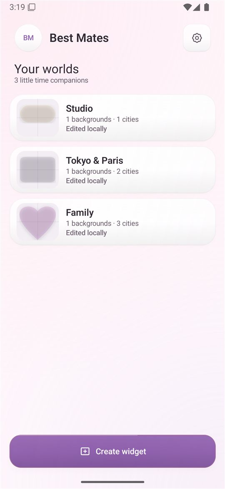 | 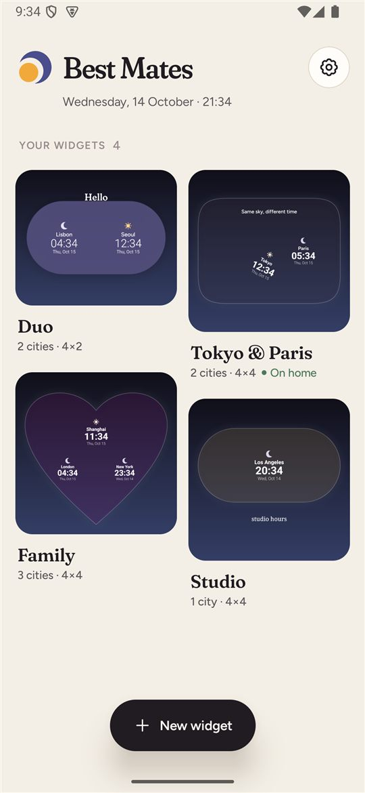 |
| Editor | 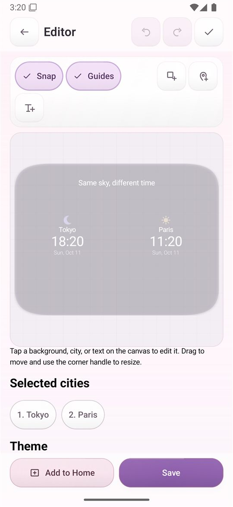 | 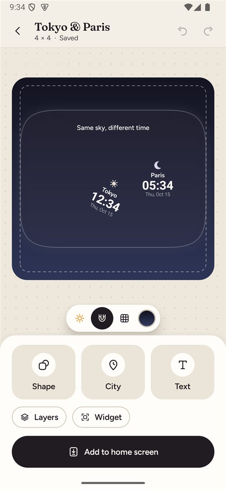 |
| Inspector | 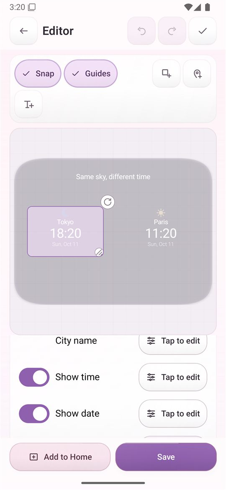 | 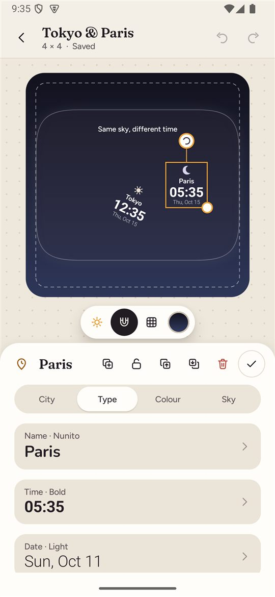 |
| Pin dialog | 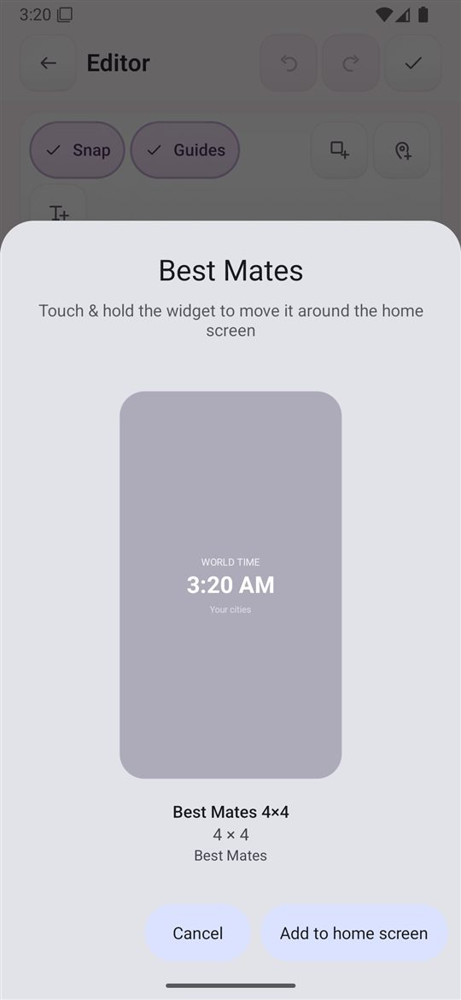 | 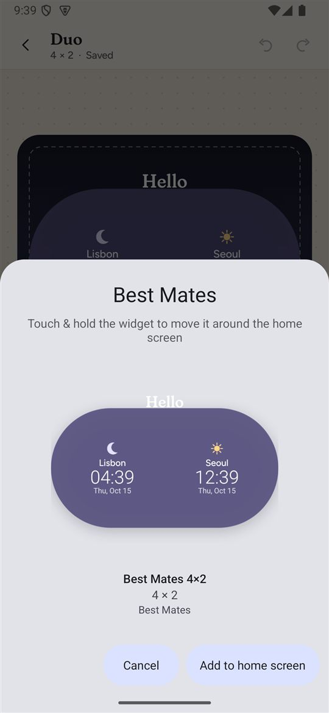 |
| Home screen | 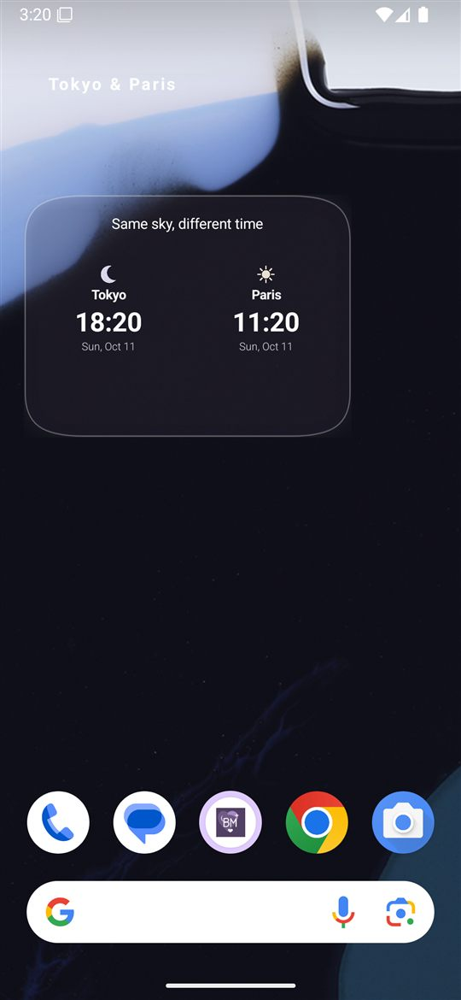 | 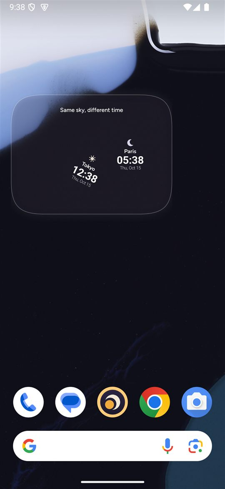 |
| Settings | 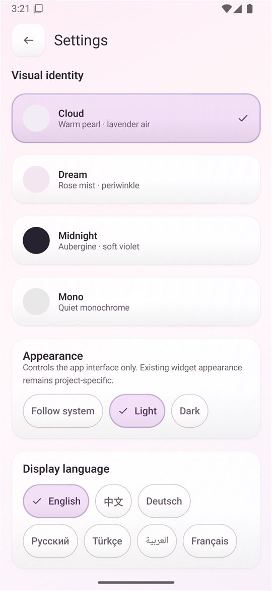 |  |

## Verification
- `assembleDebug` passes. **54 JVM unit tests pass**: migration ladder, codec round trip,
  geometry, snapping, rotation snapping, font mapping, solar schedule, city placement,
  editor history, plus the earlier suites.
- Emulator, **verified**: upgrade over 0.2/0.3 data; Workspace ordering, creation,
  selection, rename, duplicate and delete; editor select, drag, rotate, add
  shape/city/text, inspector tabs, font gallery, city search, autosave, undo; pin flow to
  the home screen with the real preview; bound widget refresh after an edit; rotated live
  time; dark mode; Chinese.
- **Not yet verified:** the user's Samsung SM-A5760 and One UI launcher (cell sizes, font
  substitution); landscape; Android 8–11 positioning; long-running sunrise/sunset alarms;
  accessibility with TalkBack and large font scales.

## Known limitations
- **Live time and date use system typefaces.** Launchers inflate widgets in a restricted
  context that ignores app-bundled fonts, so a ticking `TextClock` cannot use Fraunces or
  Figtree. Time and date offer 14 system styles (thin through black, narrow, serif, mono,
  script), and the editor draws the same system faces, so the preview still matches.
  City names and custom text use all 21 bundled fonts. A future "precise" mode could draw
  time in any font and redraw every minute (with exact alarms, at a battery and
  reliability cost) — see next steps.
- Live date text follows the device locale, as the launcher's `TextClock` does.
- German, French, Russian, Turkish and Arabic cover the most visible strings only; the
  rest falls back to English. Arabic right-to-left layout is unreviewed.
- The sun/moon artwork library is the existing BM set. The deferred Celestial final pass
  is still open.
- Snapping thresholds and handle sizes need checking by hand on the real phone.

## Installing on the Samsung (not done — needs your go-ahead)
The phone has `com.bestmates.worldclock` 0.3.0 (versionCode 3) with real projects. This
build is 0.4.0 (versionCode 10), so it installs as an upgrade **only if it is signed with
the same key** as the installed app.

Known signing certificates (SHA-256):
- This build and the September builds in the original `Android Development` folder:
  `c7cef145e25856271b04b2281e443e58f1ac945a8a1ea2c2024b97478bf42241` (this PC's debug key).
- The public `BestMates-v0.1.0-debug.apk` release asset:
  `cd8d1b432ff677abf5f219f35f2e6155da5e738a4c92eed583b45b3bdca194f8` (a different key).

Read-only check of the phone (copies the installed APK to the PC; changes nothing):

```powershell
$apk = (C:\ADB\adb.exe shell pm path com.bestmates.worldclock).Replace("package:", "").Trim()
C:\ADB\adb.exe pull $apk "$env:TEMP\bm-installed.apk"
& "C:\Users\JCLXJ\AppData\Local\Android\Sdk\build-tools\35.0.0\apksigner.bat" verify --print-certs "$env:TEMP\bm-installed.apk"
```

If it prints `c7cef145…`, `adb install -r app\build\outputs\apk\debug\app-debug.apk`
upgrades in place and migrates the projects; each raw pre-v9 payload is backed up first.
If it prints anything else, do **not** uninstall, because that would erase the projects.
Export them first (a next step), or build with the matching key.

## Next steps
1. Phone acceptance on the Samsung: cells, fonts, snapping feel, widget sizes 2×1 to 4×5.
2. A precise-typography option for live time (bitmap time with exact minute alarms),
   off by default.
3. An analog clock element. `AnalogClock` with custom dial and hand icons is remotable
   on API 31+, so it would stay live with artwork in the Best Mates style.
4. Templates in the creation sheet (Duo, Family, Postcard).
5. Celestial final pass: a redrawn sun/moon family in the mark's language.
6. Project export/import (JSON) as a user-facing backup.
7. Complete translations and an RTL review; TalkBack and font-scale pass.
