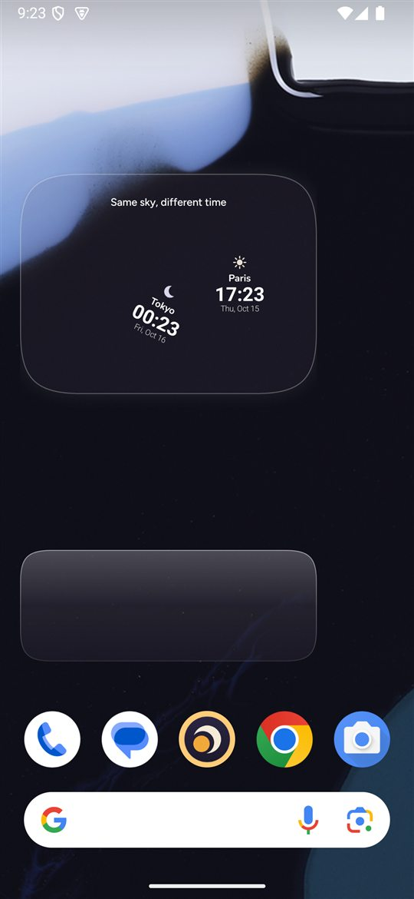
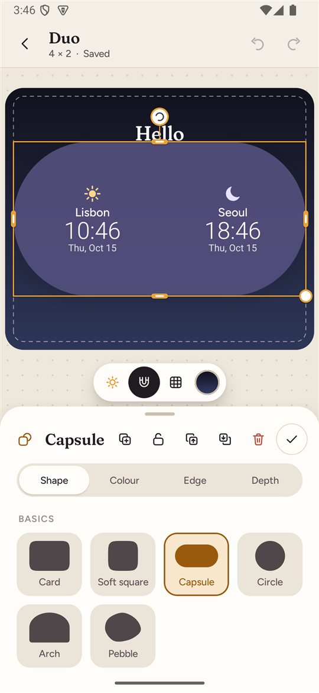
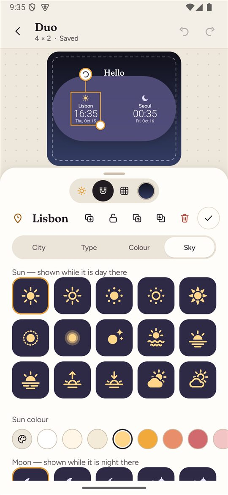
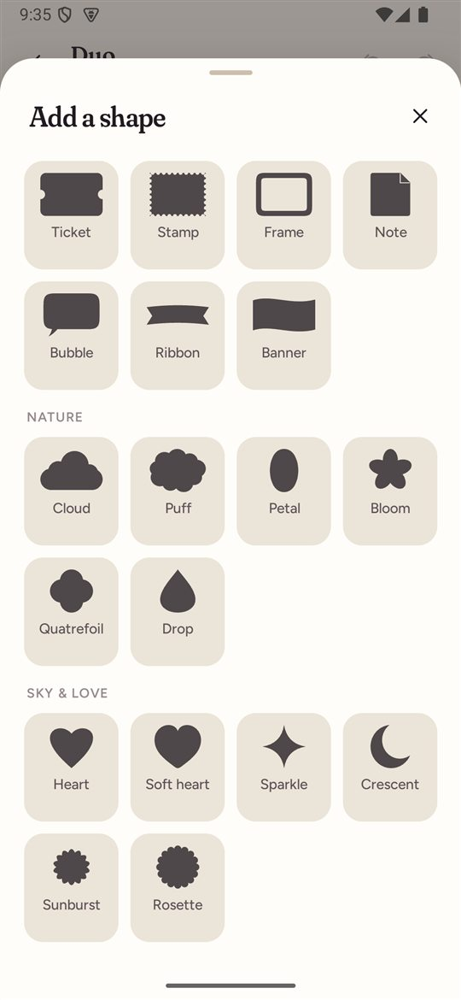
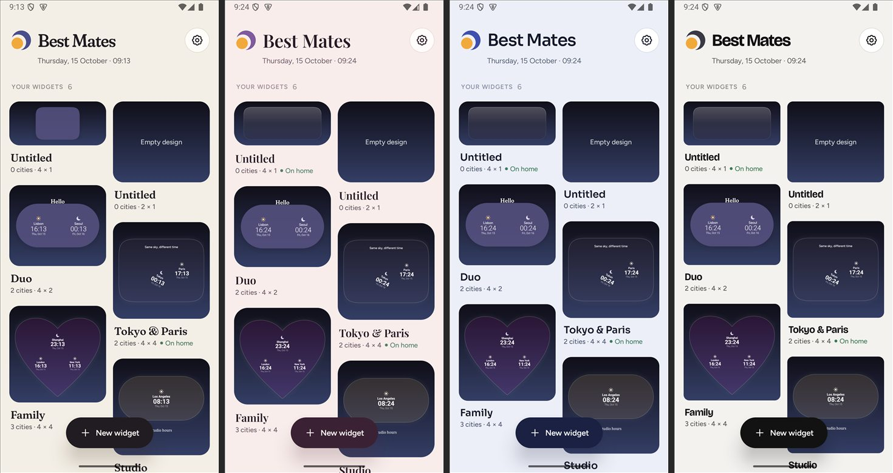
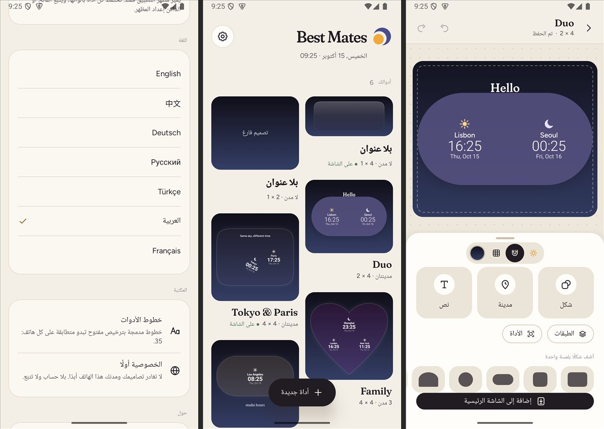

# Best Mates

**Languages:** [English](README.md) · [中文](docs/README_zh-CN.md) · [Français](docs/README_fr.md) · [Deutsch](docs/README_de.md) · [Русский](docs/README_ru.md) · [العربية](docs/README_ar.md) · [Türkçe](docs/README_tr.md)

Best Mates is an open-source Android world-clock widget editor designed for people who want personal, beautiful, and tactile home-screen widgets without having to master complex formula-driven widget builders.

> **Status: v0.5.0 Final Milestone — Project Complete.** Best Mates v0.5.0 is the consolidated and accepted final release for this development stage. It introduces the full "Daybook" visual language, 29 original celestial sun/moon artworks, 25 geometric shapes with Mist frosted finishes, proportion-matching home-screen rendering, 7 localized languages (with native right-to-left Arabic layout), magnetic editor snapping, and extensive stability hardening. Active feature development is concluded, and the project is in community-driven maintenance mode.

---

## Visual Gallery

| Home Screen Widgets | Canvas Editor (4×2) |
| :---: | :---: |
|  |  |

| Celestial Artwork & Picker | Shape Library |
| :---: | :---: |
|  |  |

| Theme System (Daybook / Rosewater / Nocturne / Studio) | Arabic RTL Localization |
| :---: | :---: |
|  |  |

---

## What works today

- **Multiple Widget Projects:** Create, duplicate, rename, and manage independent widget configurations in a unified Workspace gallery.
- **Proportional Canvas Editor:** Real-time design canvas sized directly to target widget proportions (1×1, 2×1, 2×2, 3×3, 4×1, 4×2, 4×3, 4×4).
- **Intelligent Snapping & Layer Selection:** Magnetic snap guides for edges, centers, thirds, quarters, and sibling elements. Direct one-tap selection of cities or text overlapping shapes.
- **Daybook Celestial Set:** 29 original geometric sun and moon icons, automatically reflecting daylight/night status calculated via solar coordinates.
- **Shape & Material System:** 25 geometric shapes organized into four families (including 13 additions introduced in v0.5.0), featuring Mist (frosted finish), Glass, and Solid styling.
- **Typography:** 21 bundled open-license typefaces (Fraunces, Figtree, Bricolage Grotesque, JetBrains Mono, Baloo 2, Space Grotesk, etc.) alongside 14 live system font styles.
- **Complete Visual Identities:** Four curated themes — **Daybook**, **Rosewater**, **Nocturne**, and **Studio** — with full Light, Dark, and System appearance support.
- **Offline & Online City Search:** Instant offline access to global cities via a bundled GeoNames database, supplemented by online search via Open-Meteo Geocoding.
- **International Localization:** Complete interfaces in seven languages: English, 中文 (Simplified Chinese), Français (French), Deutsch (German), Русский (Russian), العربية (Arabic with native RTL layout), and Türkçe (Turkish).
- **Home-Screen Precision:** Full bleed rendering with zero edge-cropping or drop-shadow spilling on modern Android launchers (including Samsung One UI).
- **Privacy by Design:** All widget configurations remain strictly on-device. No accounts, telemetry, ads, or background location tracking.

*Note on feature boundaries:* This release focuses strictly on world clocks and typography. Live weather forecasts, analog clock hands, and cloud synchronization / file import-export are intentional non-goals for this release, not unfinished defects.

---

## Download & Installation

Download **`BestMates-v0.5.0-debug.apk`** from this repository's [Releases](../../releases) page.

- **File:** `BestMates-v0.5.0-debug.apk`
- **Size:** ~35.0 MB (35,066,983 bytes)
- **SHA-256 Digest:** `7BE893961D26D839D7CF7C2B0093825D0F008AE785462947BC7F595BBF2C4B03`

### Installation Steps

1. Download the APK file directly to your Android device.
2. When prompted by Android, grant permission to install unknown apps from your browser or file manager.
3. Launch **Best Mates**, create or customize a widget, and tap **Add to Home**.
4. If your launcher does not automatically display the widget pin prompt, long-press on your home screen and select **Best Mates** from the widget drawer.

> [!WARNING]
> **Crucial Signature & Data Safety Notice:**
> - Best Mates v0.5.0 is distributed as a **debug-signed public build**. Standard Android package management blocks in-place upgrades if the APK signing certificate differs from an already installed version (such as earlier preview builds v0.1.0 or v0.2.0).
> - **DO NOT uninstall Best Mates if you have existing custom projects that you need to retain.**
> - All project configurations live locally in app-private storage, and Best Mates does not currently include a complete export/import backup feature. Uninstalling the app permanently erases all locally saved widget projects.
> - If you are currently using an earlier build and rely on your existing configurations, please preserve your current installation until a verified data migration or backup method is available. Do not uninstall as a routine troubleshooting step for signature conflicts.
> - For new users or clean installations without unbacked-up project data, the v0.5.0 APK can be installed directly.

---

## Maintenance Policy & Project Status

With the v0.5.0 milestone, Best Mates has reached its planned design and functionality goals and is considered officially complete:
- **No additional features are planned.**
- **No further visual redesigns are planned.**
- **No unnecessary architectural reconstructions will be performed.**
- **Community maintenance:** [GitHub Issues](../../issues) remains open for the community to report critical bugs, security vulnerabilities, or necessary Android platform compatibility adjustments.
- **Future updates:** Maintenance releases will be evaluated strictly on an individual basis as needed to preserve stability and platform compatibility.

---

## Building from Source

Best Mates requires Android SDK Platform 35 and JDK 17.

```powershell
# Clone the repository
git clone https://github.com/jclllycf/best-mates-world-clock.git
cd best-mates-world-clock

# Build debug APK and run tests
.\gradlew.bat testDebugUnitTest lintDebug assembleDebug
```

The compiled APK will be output to `app/build/outputs/apk/debug/app-debug.apk`.

---

## Attribution & Licences

- **Source Code:** Released under the [Apache License 2.0](LICENSE).
- **Geographical Data:** Bundled city and timezone reference data derived from [GeoNames](https://www.geonames.org/) under [Creative Commons Attribution 4.0](https://creativecommons.org/licenses/by/4.0/).
- **Online Geocoding:** Powered by [Open-Meteo Geocoding API](https://open-meteo.com/en/docs/geocoding-api).
- **Bundled Fonts:** All included typefaces are open-source under the [SIL Open Font License 1.1](http://scripts.sil.org/OFL) or Apache License 2.0.
- **Third-Party Icons:** Open-source vector icons from Lucide, Tabler, Phosphor, Fluent UI, Iconoir, Material Design, and Meteocons. Details are in [THIRD_PARTY_NOTICES.md](THIRD_PARTY_NOTICES.md).

Copyright 2026 Best Mates Contributors.
